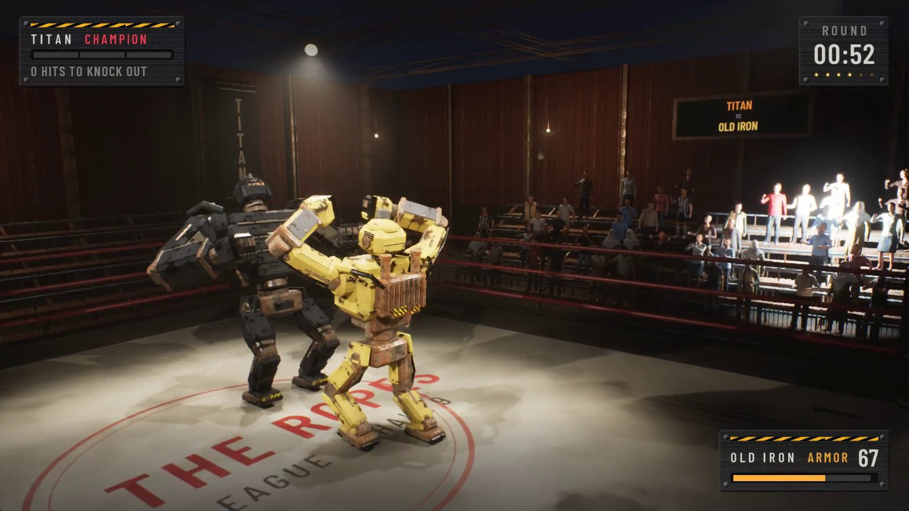
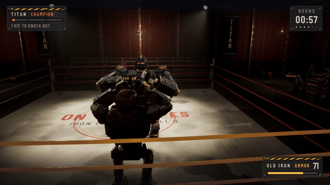
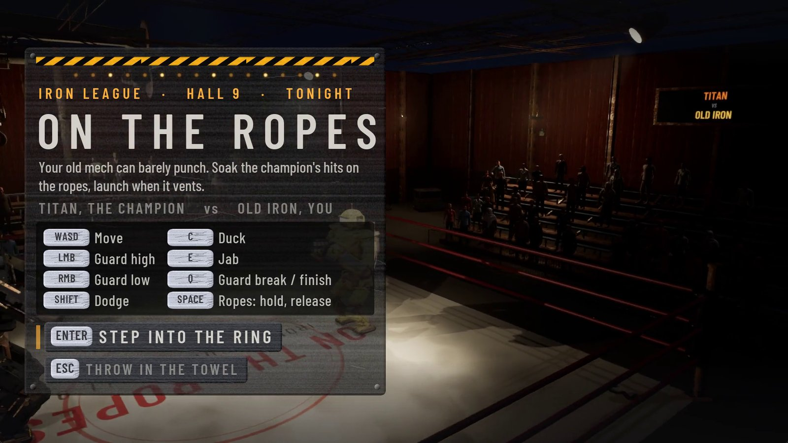
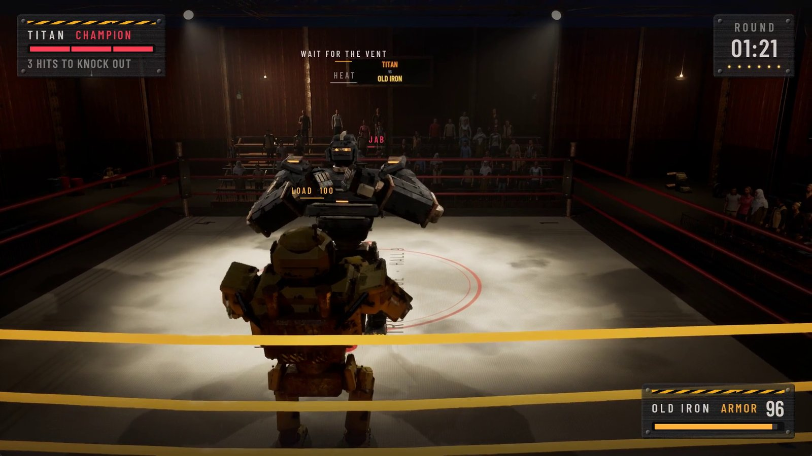
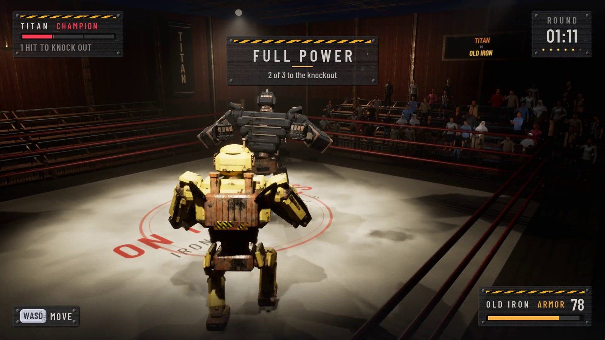
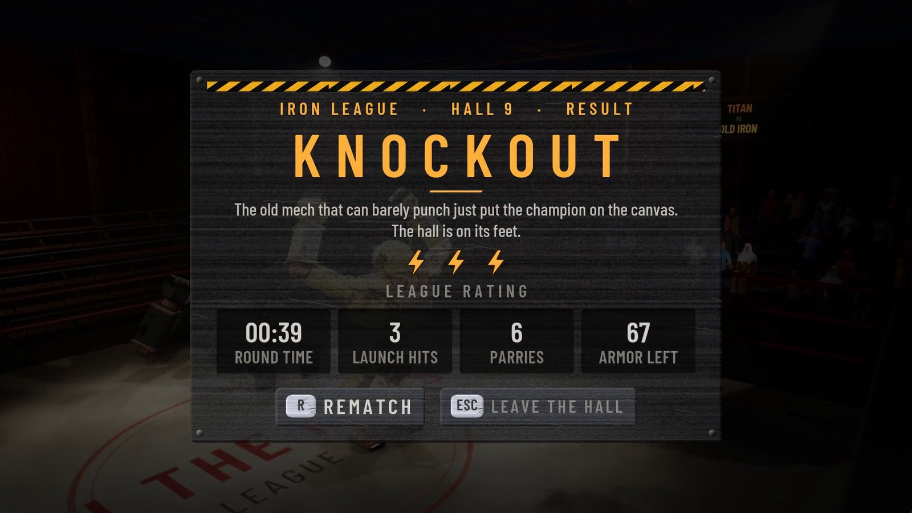

# Spring Loaded

*You can't punch. Lean on the ropes, launch when it vents.*

A third-person mech boxing game made in **Unreal Engine 5.8** with gameplay written entirely in C++.

The project still uses its working title, **On the Ropes** (`OntheRopes.uproject`), which you'll see on the start screen.

## About

Rope-a-dope with steel. Your rusty mech can't throw a punch. Guard high or low, lean into the ropes to soak up the champion's hits and store their energy, then wait for it to overheat and vent. Release and the ropes fling you across the ring for a clean hit. Every rope you load frays, and a snapped side becomes a ring-out edge.

**Goal:** Land three full-power spring launches on the champion inside the 90-second bout. Lose if your armour hits zero, you're pushed out through a snapped side, or the final bell rings.

**[Watch the full gameplay video (MP4, with sound)](media/gameplay.mp4)**

## Controls

| Key | Action |
|---|---|
| W A S D | Move |
| Left mouse (hold) | Guard high |
| Right mouse (hold) | Guard low |
| Space (hold, then release) | Lean on the ropes, release to launch |
| Shift | Dodge a haymaker |
| Q | Break the champion's guard |
| R | Restart |

## Highlights

- Elastic ropes that store energy per absorbed hit, fray and snap
- A champion that overheats, vents and learns to drag you off the ropes
- Both mechs and the hall built in code
- Knockout, ring-out and final-bell endings

## Screenshots

| | |
|---|---|
|  Start screen |  Guarding on the loaded ropes |
|  Full power stored |  Knockout |

## Play it

1. Install **Unreal Engine 5.8** (Epic Games Launcher) and **Visual Studio 2022** with the *Game development with C++* workload.
2. Download `SpringLoaded-UE5.8-project.zip` from the [Releases](../../releases) page and unzip it.
3. Double-click `OntheRopes.uproject` and say **Yes** when it asks to build the modules.
4. Press **Play** in the editor, or right-click the `.uproject` and choose *Launch game*.

This repository holds the source and config. The levels, art and audio (`Content/`) are only in the release zip, because they are too large for git.

## Project layout

| Folder | What's in it |
|---|---|
| `Source/OntheRopes/` | all gameplay code (C++) |
| `Config/` | engine, input and game settings, including tuning values |
| `media/` | screenshots for this page |

## Credits and licence

Third-party assets (all free to use and redistribute) are listed with their authors and licences in [CREDITS.md](CREDITS.md). The licence and notice files that came with them are in [licenses/](licenses/) and in the release zip.
The code and original content are **all rights reserved**: see [LICENSE](LICENSE).
